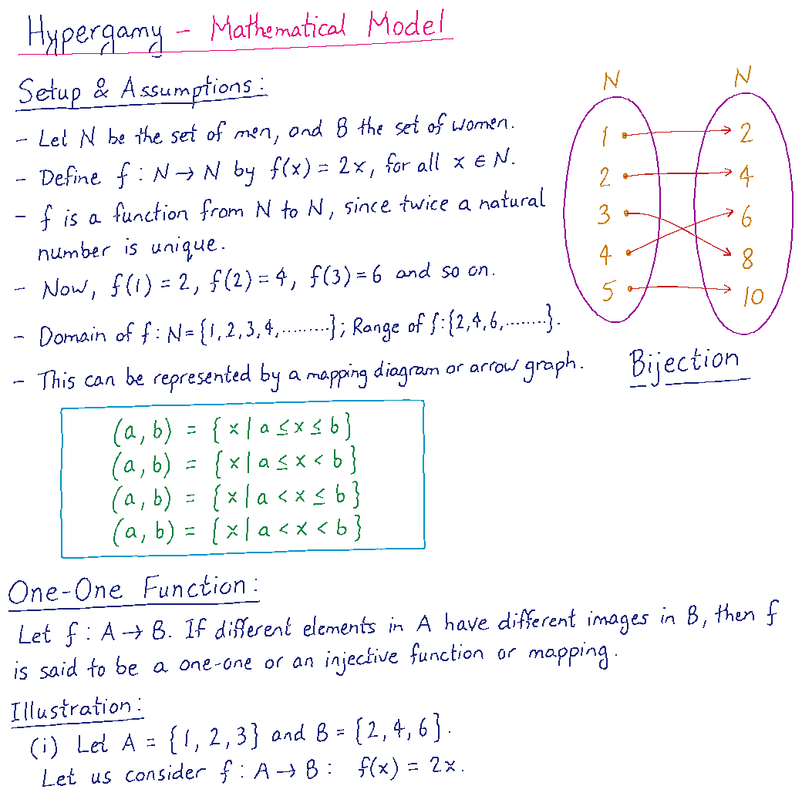

# Example: a page of handwritten maths notes



A full page of handwritten notes (text, a boxed list of equations and a
mapping diagram), drawn about 170 × 170 mm. Colours in the preview show the
drawing order.

## Draw it as-is

[`hypergamy_v2.gcode`](hypergamy_v2.gcode) is ready to draw:

```
PY tools/printer_link.py send examples/hypergamy/hypergamy_v2.gcode
```
then on the printer, with the pen touching the paper at the front-left corner:
```
~/pen/draw.sh hypergamy_v2.gcode
```
Leave about 170 mm of room to the right and toward the back.

## How the custom drawing order works

The plain converter ([`image_to_gcode.py`](../../image_to_gcode.py)) draws in
whatever order keeps the pen travel short.
[`hypergamy_job.py`](hypergamy_job.py) shows how to control the order for one
particular page. It splits the picture into regions (in the photo's own pixel
coordinates, set at the top of the file) and draws them as:

1. text above the equation box
2. the four equations, all in one go
3. text below the box
4. the mapping diagram: numbers and dots, then each oval as **one continuous
   loop** (`oval_loop`), then each arrow as **one smooth sweep plus its head**
   (`arrow_paths`)
5. "– Mathematical Model" and the title underline (one stroke)
6. the box around the equations, last

It reuses the converter's building blocks (`load_ink`, `trace_ink`,
`order_paths`, `join_close`, `smooth`, `gcode_lines`), so it's a good starting
point if you want a custom order for your own page. Copy it and change the
region coordinates and the `order` list.

The original photo isn't included. To rerun the script on your own photo of
a similar page:
```
PY examples/hypergamy/hypergamy_job.py photo.webp out.gcode --preview out_preview.png
```
