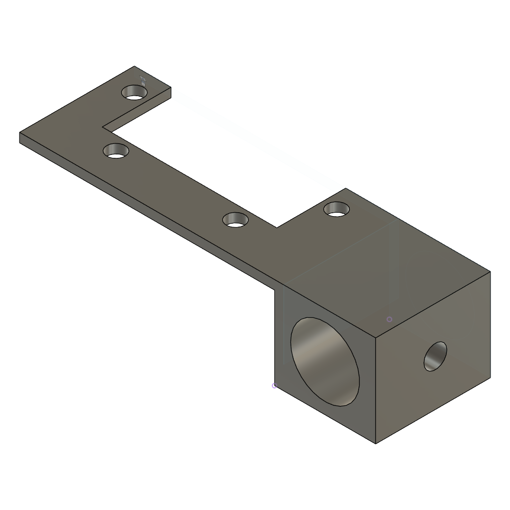

# Pen holder

[`pen_holder_cover.3mf`](pen_holder_cover.3mf) is a printable pen holder
for the Neptune 4's print head:

* the flat **bracket** with four screw holes fixes onto the print head where
  the hotend cover sits
* the **block** at the end holds the pen upright in its large hole
* the small **side hole** takes a screw that clamps the pen in place

Open the `.3mf` in your slicer (Elegoo Cura, OrcaSlicer, PrusaSlicer…) and
print it in PLA or PETG. Print it **before** you remove the hotend, because
you can't 3D print once the printer is set up as a pen plotter.

When fitting it:
* the pen tip must sit **a few mm below the nozzle**, so the nozzle can never
  touch the paper
* keep the print-head cable plugged in (the hotend can hang loose)
* make sure nothing snags the cable as the head moves
